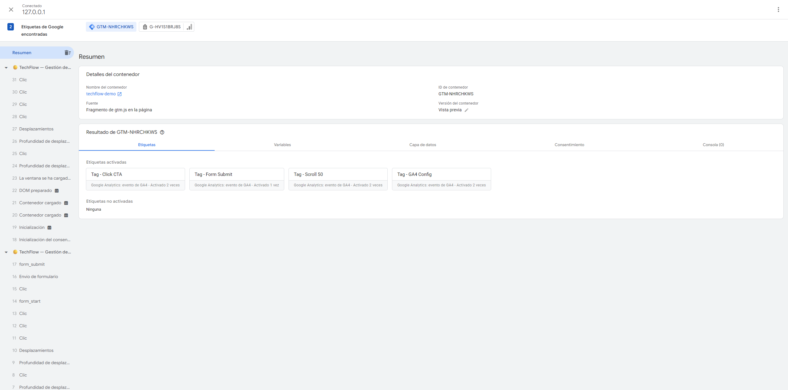

# Proyecto 3 — Debugging de Tracking

## Objetivo
Documentar errores reales encontrados durante la implementación de 
GTM y GA4, mostrando el proceso de diagnóstico y solución.

## Herramientas utilizadas
- Google Tag Manager (Preview Mode / Tag Assistant)
- Google Analytics 4 (Tiempo Real)
- Chrome DevTools

---

## Bug #1 — GTM instalado pero sin etiquetas configuradas

### Síntoma
Al verificar la instalación de GTM con Tag Assistant, el navegador
mostraba el siguiente mensaje:
> "Debes instalar una etiqueta"

Adicionalmente redirigía a crear una cuenta de Google Analytics,
lo cual generaba confusión sobre si GTM estaba bien instalado.

### Diagnóstico
El mensaje no indica un error de instalación sino que GTM estaba
correctamente instalado pero con el contenedor vacío, sin ninguna
etiqueta configurada aún.

### Solución
Se verificó la instalación correctamente usando el **Preview Mode
de GTM** en lugar de Tag Assistant:
1. GTM → botón "Vista previa"
2. Ingresar la URL del sitio
3. Confirmar mensaje "Tag Assistant Connected"

### Aprendizaje
Tag Assistant requiere etiquetas activas para dar luz verde. 
El Preview Mode de GTM es la herramienta correcta para verificar
la instalación base, independientemente de si hay etiquetas o no.

---

## Bug #2 — Eventos no visibles en la sección "Eventos" de GA4

### Síntoma
Después de configurar y disparar eventos correctamente (confirmados
en Tiempo Real), la sección **Informes → Eventos** de GA4 mostraba:
> "Integra el SDK o configura el etiquetado para empezar a obtener
> datos de eventos. Verás tus primeros informes aquí en 24 horas."

### Diagnóstico
GA4 tiene dos capas de datos con latencias distintas:
- **Tiempo Real** → datos instantáneos (segundos)
- **Informes estándar** → procesamiento con delay de hasta 24 horas

Los eventos estaban llegando correctamente. El mensaje era por
latencia de procesamiento, no por error de configuración.

### Solución
Para marcar conversiones sin esperar 24 horas se usó la ruta:
**Administrar → Eventos → Crear evento manualmente**

Se crearon los eventos `form_submit` y `click_cta` manualmente
y se marcaron como eventos clave desde esa misma pantalla.

### Aprendizaje
Siempre verificar eventos en **Tiempo Real** primero. Los informes
estándar de GA4 no son la fuente correcta para validación inmediata
durante una implementación.

---

## Bug #3 — Funnel de conversión con 0% en paso final

### Síntoma
El embudo configurado en GA4 Explorations mostraba:
- Paso 1 (Vista de página): 100%
- Paso 2 (Clic en CTA): 100%  
- Paso 3 (Envío de formulario): 0%

### Diagnóstico
Dos causas posibles identificadas:
1. El evento `form_submit` aún estaba en proceso de indexación
   (latencia de 24h mencionada en Bug #2)
2. El trigger de GTM para form_submit requería que el formulario
   tuviera validación HTML activa (atributo `required`)

### Solución
1. Se verificó en GTM Preview Mode que el evento `form_submit`
   sí se disparaba correctamente al enviar el formulario
2. Se documentó como un caso de latencia de procesamiento de GA4
3. Se tomó captura del funnel mostrando la estructura correcta
   con la anotación del comportamiento esperado

### Aprendizaje
Un 0% en un paso del funnel no siempre indica error de tracking.
El proceso de debugging requiere separar la capa de **recolección**
(GTM/GA4 recibe el evento) de la capa de **procesamiento**
(GA4 refleja el evento en informes).

---

## Bug #4 — Doble instalación: gtag.js directo + GA4 vía GTM

### Síntoma
Durante la auditoría previa a la expansión del sitio (v1.0 del Measurement
Plan) se detectó que las páginas cargaban **dos** instalaciones de GA4 en
paralelo:
1. El snippet directo de `gtag.js` con `gtag('config', 'G-HV1S1BRJ8S')`
2. El tag de configuración de GA4 dentro del contenedor GTM

### Diagnóstico
Cada instalación envía su propio `page_view` al cargar la página. En
DevTools → Network (filtro `collect`) se observan dos hits de `page_view`
por carga, lo que infla page_views, sesiones cortas y distorsiona
métricas de engagement. Es uno de los errores más comunes al migrar de
gtag.js "hardcodeado" a una gestión centralizada en GTM: la instalación
antigua queda olvidada en el código.

### Solución
1. Se removió el snippet directo de `gtag.js` de todas las páginas.
2. GA4 quedó servido **exclusivamente** vía GTM (una sola fuente de verdad).
3. Se conservó únicamente la definición de la función `gtag()` inline,
   necesaria para los comandos de Consent Mode (que viajan por el dataLayer
   y no requieren cargar la librería gtag.js).
4. Verificación: un solo hit `page_view` por carga en Network → `collect`.

### Aprendizaje
Antes de cualquier expansión de tracking, auditar **cuántas instalaciones
activas** tiene la propiedad. La regla profesional: un solo punto de
entrada (GTM) y el Measurement ID definido en una sola variable del
contenedor. Todo lo demás es deuda técnica de medición.

---

## Bug #5 — Página sin etiquetar detectada por "Cobertura de la etiqueta"

### Síntoma
El panel de diagnóstico de GA4 marcaba la cuenta como **"Urgente"** con el
aviso *"Algunas de tus páginas no están etiquetadas"*. En **Administrar →
Cobertura de la etiqueta**, de 7 páginas incluidas, 1 aparecía **Sin
etiquetar**: `/portfolio-analytics/Proyecto-2/`.

### Diagnóstico
La página de evidencia del Proyecto 2 (`Proyecto-2/index.html`) nunca tuvo
instalado el snippet de GTM. Al ampliar el sitio con el journey de TechFlow se
etiquetaron todas las páginas nuevas, pero esta quedó como punto ciego: GA4 no
media sus visitas y el reporte de cobertura la señalaba. No afectaba a los
eventos del funnel (esa página no dispara ninguno), pero sí dejaba un hueco en
la medición y disparaba la alerta de calidad del contenedor.

### Solución
1. Se añadió a `Proyecto-2/index.html` el mismo bloque que el resto de páginas:
   defaults de Consent Mode v2 → snippet de GTM en `<head>` → `noscript` en
   `<body>` → banner de consentimiento (`js/consent.js`).
2. La alerta de cobertura se re-evalúa sola en el siguiente rastreo (24–48 h);
   no se usó la opción de "ignorar", porque etiquetar la página era la
   corrección correcta, no silenciar el aviso.

### Aprendizaje
El reporte de **Cobertura de la etiqueta** es la forma de encontrar páginas
huérfanas que no envían datos. Al expandir un sitio, cada página nueva debe
llevar el contenedor: una sola URL sin etiquetar es suficiente para bajar la
calidad de la medición y generar lagunas difíciles de detectar después.

---

## Bug #6 — Evento fantasma: un tag de GA4 emitiendo su propio nombre como evento

### Síntoma
El reporte automatizado semanal ([`ga4-reporting-automation`](https://github.com/damondrc/ga4-reporting-automation))
extrae el ranking de eventos vía GA4 Data API. En el informe del **20 de julio de 2026**
apareció, en segunda posición, un "evento" que no existe en el Measurement Plan:

```
eventName,eventCount
page_view,281
Tag - GA4 Config,274     <-- no está en el diccionario de eventos
scroll_50,233
scroll,157
form_submit,151
```

`Tag - GA4 Config` no es un nombre de evento: es el **nombre de una etiqueta del
contenedor GTM**, siguiendo la convención `Tag - <descripción>` definida en
[GTM_GOVERNANCE.md](../docs/GTM_GOVERNANCE.md). Un nombre de tag no debe aparecer
nunca como valor de la dimensión `eventName` en GA4.

### Diagnóstico

**1. No era un pico aislado.** Revisando el histórico de las corridas automatizadas
del reporte, el evento estaba presente desde la primera extracción y su conteo
crecía en paralelo al de `page_view`:

| Corrida | `page_view` | `Tag - GA4 Config` | Ratio |
|---|---|---|---|
| 2026-07-04 | 2 | 3 | 1.500 |
| 2026-07-06 | 268 | 264 | 0.985 |
| 2026-07-13 | 280 | 273 | 0.975 |
| 2026-07-20 | 281 | 274 | 0.975 |

Evidencia en crudo: [`evidencia/bug06_serie_corridas.csv`](evidencia/bug06_serie_corridas.csv)
y [`evidencia/bug06_top_events_2026-07-20.csv`](evidencia/bug06_top_events_2026-07-20.csv).

**2. La proporción es la pista.** Un ratio estable de ~0.98 respecto a `page_view`
significa que el evento se dispara **una vez por carga de página**, es decir, con el
mismo trigger que la configuración de GA4. No es un evento de interacción: es un
duplicado estructural del `page_view`.

**3. Causa raíz.** En el contenedor existía una etiqueta de tipo **GA4 Event**
(`gaawe`) cuyo campo *Event Name* había quedado con el nombre de la propia
etiqueta, `Tag - GA4 Config`, en lugar de un nombre de evento válido. Estaba
asignada a un trigger que se ejecuta en cada carga de página (de ahí el ratio
~1:1 con `page_view`). GTM la ejecutaba en cada carga junto al tag de
configuración, y GA4 la registraba como un evento más, sin forma de distinguirla
de uno legítimo.

**4. Impacto en los datos.**
- Inflaba `eventCount` en ~274 eventos sobre la ventana de 28 días (≈17 % del total).
- Contaminaba el informe de *Top events*, desplazando eventos reales del ranking.
- Cualquier métrica derivada de "eventos por sesión" quedaba sobreestimada.
- **No** afectaba a sesiones, usuarios ni al funnel de ecommerce: el evento fantasma
  no participa de ningún paso del embudo ni está marcado como evento clave.

### Solución
1. Se desactivó la etiqueta en el contenedor GTM y se publicó una versión nueva.
2. Se exportó el contenedor corregido a [`gtm/container-export.json`](../gtm/container-export.json).
3. Se añadió una validación al [Measurement Plan](../docs/MEASUREMENT_PLAN.md):
   todo `eventName` observado en GA4 debe existir en el diccionario de eventos;
   cualquier valor fuera del diccionario se trata como defecto de implementación.
4. **Los datos históricos no se corrigen.** GA4 no permite borrar eventos ya
   recolectados y los data filters no son retroactivos. El evento fantasma
   permanece en el histórico y seguirá apareciendo en la ventana móvil de 28 días
   del reporte hasta aproximadamente el **17 de agosto de 2026**.
5. Como siguiente paso (Bloque B), en `ga4-reporting-automation` se excluirá el
   evento explícitamente vía `FilterExpression` en la query, con un comentario que
   documente qué se excluye, desde cuándo dejó de generarse y por qué el filtro es
   temporal. Hasta que ese cambio esté implementado, el evento sigue apareciendo en
   el ranking del reporte.

### Aprendizaje
El hallazgo no vino de una revisión manual del contenedor, sino de la **capa de
reporting**: fue el pipeline automatizado el que expuso un defecto de la capa de
recolección que llevaba semanas activo y que no generaba ninguna alerta en GA4.

De ahí dos reglas que incorporo al proceso:

- **El diccionario de eventos es un contrato verificable, no documentación.** Si
  GA4 devuelve un `eventName` que no está en el Measurement Plan, es un bug —
  aunque el dato "se vea bien" en los informes.
- **Un evento cuyo conteo es proporcional a `page_view` casi nunca mide una
  interacción.** La proporción entre eventos es una herramienta de diagnóstico
  tan válida como el Preview Mode, y es la única que funciona de forma retroactiva
  sobre datos ya recolectados.

Es también la razón de ser del reporting automatizado: no solo comunica métricas,
sino que actúa como control de calidad continuo sobre la implementación.

---

## Bug #7 — Evento perdido en la navegación: `select_item` sub-registrado

### Síntoma
Al añadir el embudo al reporte automatizado, el paso 2 resultó **menor que el
paso 3**, algo imposible en un funnel real: no se puede iniciar el registro sin
haber elegido antes un plan.

| Paso del journey | Evento | Conteo (28 días) |
|---|---|---|
| 1. Ver planes | `view_item_list` | 47 |
| 2. Elegir plan | `select_item` | **7** |
| 3. Iniciar registro | `begin_checkout` | **33** |
| 4. Crear cuenta | `sign_up` | 17 |
| 5. Conversión | `purchase` | 18 |

`begin_checkout` se dispara al cargar `registro.html`, y a esa página solo se
llega pulsando "Elegir plan". Por tanto `select_item` debería ser **como mínimo**
igual a `begin_checkout`. Faltaba aproximadamente el 79 % de los eventos.

### Diagnóstico

**1. No es comportamiento de usuario, es pérdida de datos.** Los otros cuatro
eventos del embudo se disparan en el evento `load` de su página y ninguno
presenta anomalías. El único que se dispara **en un clic que además navega** es
`select_item` — y es el único que falta.

**2. Causa raíz: una condición de carrera con la descarga de la página.** El
handler original empujaba el evento y navegaba tras un retardo fijo:

```js
TFTracking.selectPlan(plan);
setTimeout(function () {
  window.location.href = 'registro.html?plan=' + plan;
}, 150);   // "pequeño delay para asegurar el push"
```

El `dataLayer.push()` es síncrono, pero lo que importa no es el push: es la
petición HTTP que GTM envía a GA4 *después* de procesarlo. Ese trayecto —
evaluar el trigger, ejecutar la etiqueta, construir y enviar el hit— no cabe de
forma fiable en 150 ms. Cuando el navegador descarga la página, cancela las
peticiones en vuelo y el evento se pierde. Los 7 que sí llegaron son las
sesiones en las que la red respondió a tiempo: **un fallo intermitente, que es
justo el que no se detecta con una prueba manual** — al probarlo en Preview Mode
el evento aparece, porque el push ocurre siempre.

**3. Por qué un retardo fijo nunca es la solución.** Subirlo a 500 ms o 1 s
reduciría la pérdida a costa de hacer el sitio perceptiblemente más lento, y
seguiría fallando en conexiones peores. El retardo no espera al evento: espera
a un número inventado.

### Solución
Se sustituyó el retardo por el **`eventCallback` del dataLayer**: GTM lo invoca
cuando las etiquetas del evento ya se dispararon, de modo que la navegación
ocurre por confirmación y no por reloj.

```js
function go() {                       // idempotente: callback y red de
  if (navigated) return;              // seguridad compiten por navegar
  navigated = true;
  window.location.href = target;
}
TFTracking.selectPlan(plan, go);      // -> eventCallback + eventTimeout: 1200
setTimeout(go, 1200);                 // red de seguridad si GTM no responde
```

Tres detalles que hacen que el arreglo sea robusto:

1. **`eventTimeout`** en el push: si una etiqueta no responde, GTM llama igual
   al callback en lugar de dejarlo colgado.
2. **Red de seguridad en la página**: si GTM está bloqueado por un ad blocker,
   `eventCallback` no se ejecuta *nunca*. El usuario nunca debe quedar atrapado
   por culpa de la analítica.
3. **`go()` idempotente**: callback y red de seguridad pueden dispararse ambos;
   la bandera evita una doble navegación.

### Verificación
El embudo del reporte semanal es la comprobación: cuando la ventana móvil de 28
días se renueve, `select_item` debe situarse entre `view_item_list` y
`begin_checkout`. La alerta automática de "inversión del embudo" del reporte
—la misma que destapó este bug— dejará de dispararse.

### Aprendizaje
Cualquier evento que compita con una navegación necesita `eventCallback`; un
`setTimeout` solo cambia la probabilidad de perderlo. Es la versión de medición
de una condición de carrera clásica: el código "funciona" en las pruebas, falla
en producción de forma proporcional a la latencia del usuario, y no deja ningún
error visible.

Y, de nuevo, el hallazgo llegó desde el **análisis**, no desde la
implementación: la relación entre pasos era imposible, y esa imposibilidad
—no una alerta de la herramienta— fue la señal. Por eso el reporte incorpora
ahora una comprobación explícita de monotonía del embudo, y no solo gráficos.

---

## Herramienta principal de debugging: GTM Preview Mode



El Preview Mode muestra en tiempo real:
- Qué tags se dispararon
- Qué trigger los activó
- Los valores del dataLayer en ese momento

Es la primera herramienta a usar ante cualquier problema de tracking.

---

## Conclusión

Los 7 bugs documentados reflejan errores comunes en implementaciones reales de
GTM + GA4: desde confusión con herramientas de verificación hasta doble
instalación de GA4, páginas huérfanas sin etiquetar, un evento fantasma
generado por una etiqueta mal configurada y un evento perdido por una condición
de carrera con la navegación. Los cinco primeros se detectaron durante la
implementación; **los dos últimos los detectó el pipeline de reporting**, semanas
después y desde los datos, lo que cierra el ciclo entre recolección y análisis.
El patrón de solución siempre sigue este orden:

1. Verificar recolección (GTM Preview Mode)
2. Verificar recepción (GA4 Tiempo Real)  
3. Verificar procesamiento (GA4 Informes — esperar 24h si es necesario)